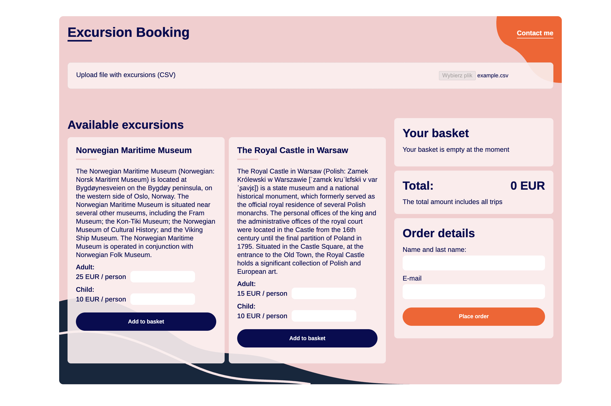

# Excursion Booking

A responsive excursion booking application built with vanilla JavaScript, HTML and CSS.

The application allows users to import excursion data from a CSV file, select the number of adults and children, add excursions to a basket and place an order.



## CSV format

The application expects a CSV file with the following columns:

```text
id,title,description,adultPrice,childPrice
```

Each row represents one excursion.

All values in the example CSV file are enclosed in double quotes (`"`). This is especially important for the `description` field, as it may contain commas. Quoting the field ensures that commas inside the description are treated as part of the text rather than as column separators.

Example:

```text
"1","Oslo","Norwegian Maritime Museum – The Norwegian Maritime Museum (Norwegian: Norsk Maritimt Museum) is located at Bygdøynesveien on the Bygdøy peninsula, on the western side of Oslo, Norway. The Norwegian Maritime Museum is situated near several other museums, including the Fram Museum; the Kon-Tiki Museum; the Norwegian Museum of Cultural History; and the Viking Ship Museum. The Norwegian Maritime Museum is operated in conjunction with Norwegian Folk Museum.","200","100"
"2","Warsaw, The Royal Castle","The Royal Castle in Warsaw (Polish: Zamek Królewski w Warszawie) is a state museum and a national historical monument, which formerly served as the official royal residence of several Polish monarchs. The personal offices of the king and the administrative offices of the royal court were located in the Castle from the 16th century until the final partition of Poland in 1795. Situated in the Castle Square, at the entrance to the Old Town, the Royal Castle holds a significant collection of Polish and European art.","150","75"
```

A ready-to-use example file is available here:

[Download example.csv](./data/example.csv)

### Data sources

The excursion descriptions in the example CSV are based on information from Wikipedia:

- [Norwegian Maritime Museum – Wikipedia](https://en.wikipedia.org/wiki/Norwegian_Maritime_Museum)
- [Royal Castle, Warsaw – Wikipedia](https://en.wikipedia.org/wiki/Royal_Castle,_Warsaw)

## Live Demo
Coming soon.

## Technologies

- HTML5
- CSS3
- JavaScript (ES6+)

## Purpose & scope

This project was created as a frontend development project to practise working with:

- JavaScript and event handling
- forms, user input and validation
- CSV data and dynamic DOM manipulation
- responsive layouts
- semantic HTML
- CSS without a framework

The project is frontend-only and is not connected to a backend or payment system. The order form is used to practise form handling and validation; submitting the order currently displays a confirmation alert rather than sending the order to a server.

The included `example.csv` contains two excursions, but the application can handle more as long as they follow the same structure. I intentionally kept the dataset small and did not implement pagination or dynamic loading.

For a production application, I would make the CSV handling more robust to account for different formats and invalid data. With a larger dataset, I would also consider pagination or incremental loading to keep the interface fast and user-friendly.

These are intentional scope decisions for this project.

## Author

Natalia Kur

[Connect with me on Linkedin](https://www.linkedin.com/in/natalia-kur/)
